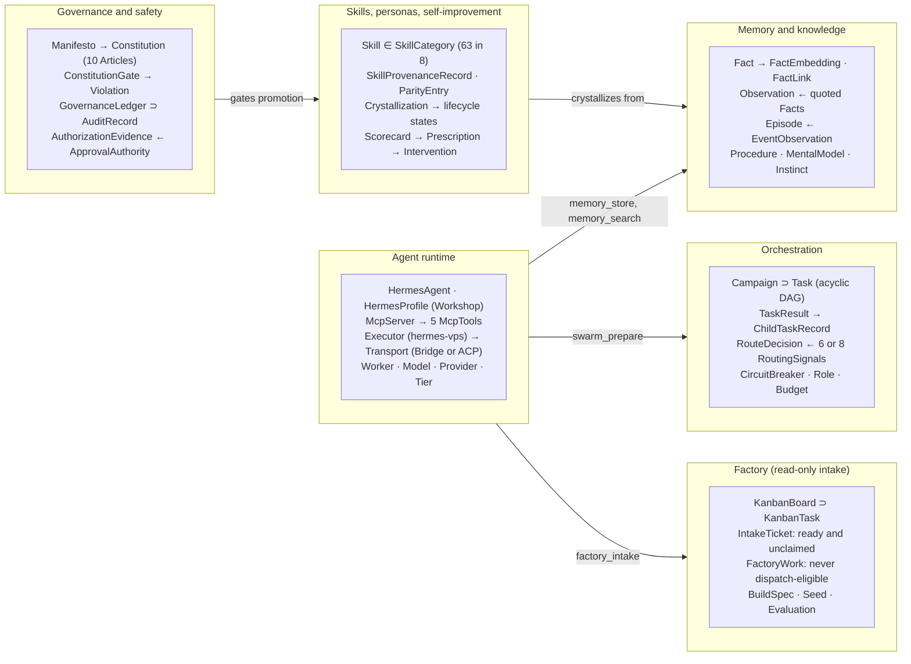

# Hermes × Zouroboros Ontology

_As of 2026-10-11 · derived from this repository at commit `ffda08f` · class names and axioms cite the files that enforce them._

## Purpose and scope

This ontology names the things that exist in this repository (commit `ffda08f`, release 0.1.0 "foundation"), how they relate, and the rules the code enforces between them. It is derived from the repository's README, `docs/`, package sources and skill manifests, not from the live Zouroboros VPS.

The repo is a distribution that joins two systems: **Hermes Agent** (conversation and tools, installed separately) and **Zouroboros** (shared memory, swarm orchestration, factory intake, governance). Everything below models that join.

Conventions used throughout:

- **Classes** are `PascalCase` (for example `Campaign`, `MemoryFact`). Subclasses are written `Child ⊑ Parent`.
- **Relations** are `camelCase` verbs read left to right (`Campaign containsTask Task`).
- **Axioms** are numbered `A1…An` and each cites the file or doc that enforces it.
- **Evidence** columns point at repo paths so every term can be traced back to source.

## Class hierarchy

Every class belongs to one of six top-level domains. The agent runtime is the entry point: its MCP tools reach memory, campaigns and factory intake, while governance gates anything that would be promoted.



Read each box as the domain's main classes; `⊃` means contains, `→` and `←` mark a relation, and the sections below define every name.

## Agent runtime

Hermes Agent is the conversational runtime; Zouroboros reaches it through one local stdio MCP server and dispatches work to it through executors. The default and only distributed executor is `hermes-vps`.

| Class | Definition | Key attributes | Realized in |
| --- | --- | --- | --- |
| `HermesAgent` | External agent runtime that holds the conversation and tools; installed separately | `hermes chat`, one-shot `hermes -z`, `hermes acp` | `docs/hermes.md` |
| `HermesProfile` | A `HERMES_HOME` directory with its own `config.yaml`, provider login and sessions | `model.default`, `model.provider`, `mcp_servers` | `integration/profile.ts` |
| `WorkshopProfile ⊑ HermesProfile` | The isolated worker profile under `~/.local/share/hermes-zouroboros/hermes` | provider login separate from normal profiles | `scripts/install.sh` |
| `McpServer` | The `hermes-zouroboros` stdio server Hermes launches from `mcp_servers` | `command`, `args`, `env`, `timeout` | `integration/mcp.ts` |
| `McpTool` | One callable tool on that server | `workshop_status`, `memory_store`, `memory_search`, `swarm_prepare`, `factory_intake` | `integration/mcp.ts` |
| `Executor` | A registered target that can run a `Task` | `id`, `executor` (`local`, `remote`), `transport`, `capabilities`, `modelPins`, `rollout` | `packages/swarm/src/types.ts` (`ExecutorRegistryEntry`) |
| `ExecutorRegistry` | Envelope listing executors, schema `executor-registry/v1` | `executors[]`; path in `SWARM_EXECUTOR_REGISTRY` | `integration/hermes-executor.ts` |
| `Transport` | How an executor is reached | `bridge` (one-shot process) or `acp` (persistent session) | `packages/swarm/src/transport/` |
| `Bridge ⊑ Transport` | Shell wrapper around `hermes -z` with timeout, usage-file failure check and temp cleanup | `HERMES_BIN`, `HERMES_TIMEOUT` (default 300 s), model and provider overrides | `integration/hermes-bridge.sh` |
| `Harness` | An agent CLI the swarm library can drive | `claude-code`, `hermes`, `gemini`, `codex`, `opencode`, `kimi` (ACP); `pi` (bridge) | `executor-registry.json` |
| `Worker` | A local Hermes process started by the swarm to execute one task | inherits `HERMES_ZOUROBOROS_ALLOW_SWARM=0` | `integration/swarm-worker.ts` |
| `Model` / `Provider` | The LLM and the service serving it, chosen by Hermes config or override | `SWARM_RESOLVED_MODEL`, `HERMES_MODEL`, `SWARM_PROVIDER` | `docs/hermes.md` |
| `ModelProvenance` | Record of which model actually served a result | `harness`, `requestedModel`, `resolvedModel`, `servingProvider`, `selectionEvidence` | `packages/swarm/src/types.ts` |
| `Tier` | A cost and capability band used to pick models | complexity: `trivial`, `simple`, `moderate`, `complex`; catalog: `light`, `mid`, `heavy` | `routing/model-catalog.ts`, `skills/zouroboros/tier-resolver` |

The swarm library names `claude-code` as its fallback executor, but this distribution's task validator rewrites every task to `hermes-vps`, so in practice the bundled CLI only ever reaches Hermes.

## Orchestration

A `Campaign` is a validated DAG of `Task`s that the swarm executes only after an explicit operator opt-in. MCP can prepare a campaign; it can never run one.

| Class | Definition | Key attributes | Realized in |
| --- | --- | --- | --- |
| `Task` | One unit of work for one executor | `id`, `task`, `priority` (`critical`, `high`, `medium`, `low`), `dependsOn[]`, `timeoutSeconds`, `executor`, `fallbackExecutors[]` | `integration/tasks.ts`, `packages/swarm/src/types.ts` |
| `TaskDAG` | The dependency graph formed by `dependsOn` across a campaign's tasks | acyclic; edges point from dependent to prerequisite | `packages/swarm/src/dag/executor.ts` |
| `Campaign` | A saved, reviewable batch of tasks (`SwarmCampaign`) | `id`, `name`, `tasks[]`, `config`, `status` (`pending`, `running`, `completed`, `failed`) | `swarm_prepare` in `integration/mcp.ts` |
| `SwarmConfig` | Run settings for a campaign | `localConcurrency`, `timeoutSeconds`, `maxRetries`, `dagMode` (`streaming`, `waves`), `routingStrategy` | `packages/swarm/src/orchestrator.ts` |
| `TaskResult` | Outcome of executing one task | `success`, `output`, `durationMs`, `retries`, `costUsd`, `effectiveExecutor`, `modelProvenance` | `packages/swarm/src/types.ts` |
| `ChildTaskRecord` | Sub-work an executor delegated while running a task | `parentTaskId`, `status` (`success`, `failure`, `blocked`, `skipped`), `source` | `packages/swarm/src/types.ts` |
| `RouteDecision` | The routing engine's choice of executor for a task | `executorId`, `compositeScore`, `breakdown`, `method` (`composite`, `fallback`) | `packages/swarm/src/routing/engine.ts` |
| `RoutingSignal` | One scored input to routing | six-signal: `capability`, `health`, `complexityFit`, `history`, `procedure`, `temporal`; eight-signal adds `budget`, `role` | `routing/engine.ts` |
| `SwarmDecisionGate` | Classifier deciding whether a request warrants a swarm at all | outputs `SWARM`, `DIRECT`, `SUGGEST`, `FORCE_SWARM` | `routing/swarm-decision-gate.ts` |
| `CircuitBreaker` | Per-executor health state | `CLOSED`, `OPEN`, `HALF_OPEN`; failures by `ErrorCategory` | `packages/swarm/src/circuit/breaker.ts` |
| `Role` | A named job bound to an executor and model | `executorId`, `model`, `budgetCapUSD`, `successCriteria` | `packages/swarm/src/roles/registry.ts` |
| `Budget` | Spend envelope for a swarm | `totalBudgetUSD`, `perExecutorLimits`, `hardCapAction` (`pause`, `abort`, `downgrade`) | `packages/swarm/src/budget/governor.ts` |
| `StagnationEvent` | Detected lack of progress during a run | `no_output`, `repetitive_output`, `progress_plateau`, `timeout_approaching` | `packages/swarm/src/stagnation/detector.ts` |
| `DecisionRow` | Hash-chained ledger entry for a routing or review decision | `traceId`, `harness`, `modelId`, `status`, `prevHash`, `hash` | `packages/swarm/src/ledger/decision-ledger.ts` |
| `ControlPlaneTask` | Durable queue row with leases, approval and idempotency (`TaskRecord`) | `state`, `attempts`, `max_attempts`, `requires_approval`, `idempotency_key` | `packages/control-plane/src/queue/task-queue.ts` |
| `HealerChain` | Ordered model fallbacks the agent-model-healer may move a job through | last rung must be open-weight; `healingEnabled` off by default | `skills/zouroboros/agent-model-healer` |

`ControlPlaneTask` and the capability runtime ship only as the upstream CLI's dependency closure; the distribution's own entry point (`integration/cli.ts`) does not start the control-plane daemon.

## Memory and knowledge

The atomic unit of memory is a `Fact`: an entity/key/value triple in one local SQLite database, scoped to a persona or `shared`. Every higher structure (observations, episodes, mental models, graph links) is built on top of facts without mutating them.

| Class | Definition | Key attributes | Realized in |
| --- | --- | --- | --- |
| `MemoryStore` | The shared SQLite database reached through MCP and the CLI | keyword search needs no API key; `ZO_MEMORY_DEFENSE` policy | `packages/memory/src/database.ts` |
| `Fact` | An entity/key/value statement (`facts` table) | `persona`, `entity`, `key`, `value`, `category`, `decay_class`, `importance`, `confidence`, `expires_at` | `packages/memory/src/facts.ts` |
| `FactEmbedding` | Vector for one fact, used for semantic search | `embedding`, `model` (default `text-embedding-3-small`) | `database.ts` |
| `FactLink` | Typed, weighted edge between two facts | `relation` (`depends_on`, `supersedes`, `caused_by`, `part_of`, `implements`, `blocks`, `related_to`), `weight` | `packages/core/src/migrations.ts`, `graph-traversal.ts` |
| `FactConflict` | A detected contradiction between two facts | `conflict_type` (`semantic`, `temporal`, `exact`), `resolution` (`superseded`, `merged`, `flagged`, `pending`) | `packages/memory/src/conflict-resolver.ts` |
| `Observation` | A consolidated belief backed by quoted fact evidence | `proof_count`, `status` (`active`, `contested`, `faded`) | `packages/memory/src/observations.ts` |
| `Episode` | Something that happened, with an outcome | `summary`, `outcome` (`success`, `failure`, `resolved`, `ongoing`), `procedure_id` | `packages/memory/src/episodes.ts` |
| `EventObservation` | Raw hook-captured tool event, redacted and deduplicated, later promoted to an episode | `hash`, `session_id`, `tool`, `redaction_count`, `promoted_at` | `packages/memory/src/event-observations.ts` |
| `Procedure` | Versioned, reusable workflow memory | `steps[]` (`executor`, `taskPattern`, `timeoutSeconds`), `success_count`, `evolved_from` | `packages/memory/src/procedures.ts` |
| `MentalModel` | A standing answer to a standing question, refreshed on an interval | `question`, `answer`, `evidence_count`, `refresh_interval_s` | `packages/memory/src/mental-models.ts` |
| `OpenLoop` | An unresolved item to carry forward | `summary`, `entity`, `status` (`open`, `resolved`) | `database.ts` |
| `CognitiveProfile` | Learned traits and preferences for one entity | `traits`, `preferences`, `interaction_count` | `packages/memory/src/profiles.ts` |
| `Instinct` | A learned trigger-response pattern with confidence | `status` (`candidate`, `active`, `suspended`, `retired`), `confidence`, `trigger`, `pattern` | `packages/core/src/instincts.ts`, `skills/zouroboros/instinct-harvester` |
| `RagCorpus` | Candidate documents qualified for retrieval | areas: `swarm`, `vault`, `autoloop`, `eval`, `persona` | `packages/rag/src/` |
| `GraphRagNode` | Relational graph over factory operations (embedded FalkorDB, read-only Cypher) | `Execution`, `Ticket`, `CostEntry`, `GateDecision`, `FactoryRecord` | `skills/zouroboros/graphrag-relational` |

> Naming note: "GraphRAG" is also used for the SQLite-side community
> summarization over the `fact_links` knowledge graph (`packages/memory`
> `graph.ts`, "GraphRAG Edge 2024"). The two are different systems: use
> vector RAG for prose similarity, the FalkorDB graph for multi-hop joins
> and "does this edge exist" questions, and the `fact_links` graph for
> memory-local association.

Decay vocabulary (unified 2026-10-13): the activity set `permanent`, `stable`, `active`, `session`, `checkpoint` (TTL none, 90, 14, 1, 1/6 days) is canonical everywhere — memory package, swarm types, and the upstream `zo-memory-system` skill. The old longevity set (`long`, `medium`, `short`) is retired; existing databases are migrated (`008_unify_decay_vocabulary`: `long`→`stable`, `medium`→`stable`, `short`→`active`; per-row `expires_at` untouched).

## Factory

The factory is modeled as read-only intake: a qualified Hermes Kanban board is read, ready and unclaimed tickets are projected, and nothing is claimed or dispatched. Upstream, a build spec and interview seed describe the work before an operator marks it ready.

| Class | Definition | Key attributes | Realized in |
| --- | --- | --- | --- |
| `KanbanBoard` | The Hermes Kanban board that tracks factory work (`board.json` + `kanban.db`) | `slug` must be `software-factory`; not `archived` | `factory/kanban-intake.ts` |
| `BoardManifest` | Trusted description of the board schema the intake accepts | `board`, `schema_version`, `schema_sha256` | `factory/kanban-intake.ts` |
| `KanbanTask` | One row of the board's `tasks` table | `id` (`t_` + 8 hex), `title`, `body`, `status`, `priority`, `created_at`, `claimed` | `factory/kanban-intake.ts` |
| `KanbanStatus` | Lifecycle position of a Kanban task | `triage`, `todo`, `scheduled`, `ready`, `running`, `blocked`, `review`, `done`, `archived` | `factory/kanban-intake.ts` |
| `BoardSnapshot` | A consistent read of the board at one moment | `board`, `schema_sha256`, `tasks[]` | `factory/kanban-intake.ts` |
| `IntakeTicket` | A ready, unclaimed task presented for planning | `identifier`, `title`, `description`, `priority`, `created_at` (ISO) | `factory_intake` MCP tool |
| `FactoryWork` | Offline, deterministic projection of a ticket, schema `factory-work/v1` | `factory_work_id` (`fw_` + SHA-256), `source: hermes`, `dispatch_eligible: false` | `factory/hermes_work_intake.py` |
| `BuildSpec` | Machine-checkable specification of a piece of work | `mission`, `factory.archetype`, `requirements`, `verifications`, `acceptanceCriteria`, `milestones`; scored to 100 | `skills/software-development/compile-build-spec` |
| `Seed` | Interview output that freezes goal, constraints and acceptance criteria | `goal`, `constraints[]`, `acceptance_criteria[]`, `ontology`, `ambiguity` | `skills/software-development/spec-first-interview` |
| `Evaluation` | Three-stage judgment of an artifact against its seed | stages `mechanical`, `semantic`, `consensus`; decision `APPROVED`, `NEEDS_WORK`, `REJECTED` | `skills/software-development/three-stage-eval` |

The archetypes a build spec may declare are `dependency`, `docs`, `bugfix`, `feature`, `refactor` and `migration`. Automatic claiming, production dispatch, specialist review enforcement, deployment and merge are explicitly outside this release ([factory boundaries](factory.md)).

## Governance and safety

Governance is a ten-article `Constitution` enforced by gates that return `ALLOW` or `BLOCK`, with every verdict written to a hash-chained, append-only ledger. Authorization is not a level; it is signed, single-use evidence scoped to one request.

| Class | Definition | Key attributes | Realized in |
| --- | --- | --- | --- |
| `Manifesto` | The founding statement defining Zouroboros's five layers | layers: Model, Harness, Agent, Memory, Control plane | `zouroboros-governance/references/ZOUROBOROS.md` |
| `Constitution` | The governing document derived from the manifesto | exactly 10 articles; canonical copy plus checked mirror | `references/CONSTITUTION.md` |
| `Article` | One principle with rationale and mechanism | I Frozen Weights · II No Evolution Without Verification · III The Metric Is Not the Target · IV Reversibility · V Human Sovereignty · VI Provenance · VII Resource Governance · VIII Layer Integrity · IX Fail-Safe Defaults · X Amendment | `references/CONSTITUTION.md` |
| `ChangeEnvelope` | A proposed change submitted to the gate (`ConstitutionInput`) | `operation`, `targetFiles[]`, `reversible`, `rollbackPlan`, `blastRadius` (`tiny`, `local`, `shared`, `high`), `humanApproved`, `provenance` | `scripts/constitution-gate.ts` |
| `ConstitutionGate` | Checks an envelope against the articles | phases `preflight`, `promotion`; exit 0 = `ALLOW`, 2 = `BLOCK` | `scripts/constitution-gate.ts` |
| `Violation` | One article breach found by the gate | `article`, `code` (for example `IV-NO-ROLLBACK`, `V-HUMAN-AUTHORIZATION`, `IX-FAIL-OPEN`) | `scripts/constitution-gate.ts` |
| `GovernanceLedger` | Append-only, SHA-256-chained audit log with HMAC anchors | genesis hash of 64 zeros; `prev_hash`, `this_hash` | `scripts/governance-ledger.ts` |
| `AuditRecord` | One ledger entry | `kind` (`genesis`, `verdict`, `bypass`, `blocked-tool-attempt`, `autonomy-decision`, `authorization-consumed`, `quarantine-move`) | `scripts/governance-ledger.ts` |
| `Verdict` | A governance judgment recorded in the ledger | `ALLOW`, `BLOCK`, `ADVISORY`; `evidence`, `rationale` | `scripts/governance.ts` |
| `Bypass` | An authorized override of one verdict | `target_verdict_id`, `reason`, `approving_authority`, `authorization_nonce` | `scripts/governance.ts` |
| `AuthorizationEvidence` | Ed25519-signed, single-use permission for one action on one resource | `actor`, `action`, `resource`, `request_fingerprint`, `expires_at` (30 to 900 s), `nonce`, `signature` | `scripts/autonomy-authorization.ts` |
| `ApprovalAuthority` | A registered public key allowed to sign authorizations | `algorithm: ed25519`, `public_key_pem`, `revoked` | `approval-authorities.json` |
| `BlockedTool` | A tool the governance persona may never dispatch | `write_file`, `terminal`, `delegate_task`, `memory`, `send_message`, and others | `scripts/governance.ts` |
| `AskGovernor` | Rate, budget and circuit control in front of model calls | `maxAttempts` 1 to 5, `budgetLimit`, circuit `closed`, `open`, `half-open` | `skills/zouroboros/ask-governor` |
| `LeakGate` | CI scan that blocks secrets, host paths, personal data and missing provenance | finding kinds `secret`, `host-path`, `personal-data`, `private-network`, `blocked-path`, `provenance`, `parity` | `scripts/ci/leak-gate.ts` |
| `SkillSecurityGate` | Risk and lifecycle checks before a skill is adopted | SkillSpector `SAFE`, `REVIEW`, `DO_NOT_INSTALL`; decision `PASS`, `HOLD`, `DENY` | `skills/software-development/skill-security-gate` |
| `Capability` / `CapabilityHandle` | Scoped, time-boxed grant of authority to perform operations on a resource | `operations[]`, `effect` (`read`, `write`), `not_before`, `expires_at`, parent handle | `packages/capability-runtime/src/contracts/` |
| `EffectClass` | How risky and recoverable a side effect is | `provider_idempotent_write`, `reconcilable_write`, `non_idempotent_write`, `destructive_write`, `compensating_write` | `capability-runtime/src/policy/effect-classes.ts` |

The repo has no numbered autonomy levels; the only graded scales are `BlastRadius` and the `off`, `shadow`, `enforce` gate modes.

## Skills, personas, self-improvement and provenance

The repo ships 63 skills across 8 categories, each traced to its source by a per-file provenance record. Self-improvement turns repeated procedures into candidate skills, but every promotion passes through human approval and the lifecycle gate.

| Class | Definition | Key attributes | Realized in |
| --- | --- | --- | --- |
| `Skill` | A folder of instructions and scripts Hermes loads by name | frontmatter `name`, `description`, `version`, `license`, `metadata.hermes.tags`; optional `references/`, `scripts/`, `assets/`, `templates/` | `skills/<category>/<name>/SKILL.md` |
| `SkillCategory` | Grouping inferred from the parent directory, not frontmatter | `zouroboros` 26, `software-development` 16, `media` 8, `email` 5, `devops` 2, `finance` 2, `gaming` 2, `research` 2 | `docs/skills.md` |
| `SkillProvenanceRecord` | Per-file trace from distributed file back to source | `sourcePath`, `sourceRevision`, `sourceSha256`, `distributedSha256`, `adaptation` | `provenance/skills.json` (358 entries) |
| `ParityEntry` | Disposition of one upstream Zouroboros skill | `disposition` (`portable`, `adapted`, `host-only`, `dropped`, `hermes-native`, `held-license`, `pending`), `distributedAs[]` | `provenance/skills-parity.json` (80 entries) |
| `SourceProvenance` | Hash list tying distributed packages to the Zouroboros VPS workspace | `files[{path, sha256}]`, `adaptations[]` | `provenance/workspace.json` |
| `Persona` | An agent identity with prompt, safety rules, skills and MCP servers | identity files `soul`, `identity`, `user`, `heartbeat` | `packages/personas/src/` |
| `SafetyRule` | One constraint attached to a persona | `category` (`safety`, `compliance`, `privacy`, `ethics`, `security`), `severity` | `packages/personas/src/types.ts` |
| `Crystallization` | A skill candidate distilled from repeated procedures or episodes | `source_kind`, `weighted_score` (threshold 3.0), `eval_status`, `approval_status`, `expires_at` | `packages/selfheal/src/crystallize/` |
| `SkillLifecycleState` | Governed stage of a crystallized or imported skill | `candidate`, `quarantined`, `approved`, `promoted`, `rejected`, `rolled_back` | `crystallize/skill-lifecycle.ts` |
| `Scorecard` | Introspection snapshot of system health metrics | metric status `HEALTHY`, `WARNING`, `CRITICAL`; trend | `packages/selfheal`, `skills/zouroboros/zouroboros-introspect` |
| `Prescription` | A proposed improvement derived from a scorecard | `seed`, optional `program`, `governorFlags`, `approved` | `skills/zouroboros/zouroboros-prescribe` |
| `Intervention` | A recorded attempt to apply a prescription, with drift checks | `stateBefore`, `stateAfter`, `drift.goodhartFlag`, `reverted` | `packages/selfheal/src/evolve/intervention-ledger.ts` |
| `AutoloopProgram` | A bounded experiment loop optimizing one metric | `metric`, `targetFile`, `maxExperiments`, `maxCostUsd`; experiment status `keep`, `discard`, `crash` | `packages/workflow/src/autoloop/` |

Only one skill, `zouroboros-governance`, carries a `GOVERNANCE.md` capability statement, so the capability-ethics coverage ratio today is 1 of 63.

## Relations

These object properties connect the classes above; cardinality is what the code enforces, not what is merely typical.

| Domain | Property | Range | Cardinality | Evidence |
| --- | --- | --- | --- | --- |
| `HermesProfile` | `connectsTo` | `McpServer` | 0..n | `integration/profile.ts` (`mcp_servers`) |
| `McpServer` | `exposes` | `McpTool` | exactly 5 | `integration/mcp.ts` |
| `McpTool` (`memory_store`, `memory_search`) | `readsWrites` | `MemoryStore` | 1 | `integration/mcp.ts` |
| `McpTool` (`swarm_prepare`) | `produces` | `Campaign` | 1 | `integration/mcp.ts` |
| `McpTool` (`factory_intake`) | `readsFrom` | `KanbanBoard` | 1, read-only | `factory/kanban-intake.ts` |
| `Campaign` | `containsTask` | `Task` | 1..20 (CLI), 1..100 (swarm schema) | `integration/tasks.ts`, `swarm-schemas.ts` |
| `Task` | `dependsOn` | `Task` | 0..20 | `integration/tasks.ts` |
| `Task` | `assignedTo` | `Executor` | 1 (`hermes-vps` in this release) | `integration/tasks.ts` |
| `Task` | `fallsBackTo` | `Executor` | 0..n, ordered | `packages/swarm/src/dag/executor.ts` |
| `Task` | `produces` | `TaskResult` | 0..1 | `packages/swarm/src/types.ts` |
| `TaskResult` | `hasChild` | `ChildTaskRecord` | 0..n | `packages/swarm/src/types.ts` |
| `TaskResult` | `hasProvenance` | `ModelProvenance` | 0..1 | `packages/swarm/src/types.ts` |
| `ExecutorRegistry` | `lists` | `Executor` | 1..n | `executor-registry.json` |
| `Executor` | `reachedVia` | `Transport` | 1 (with optional env fallback) | `transport/factory.ts` |
| `Executor` | `hasBreaker` | `CircuitBreaker` | exactly 1 | `circuit/breaker.ts` |
| `RouteDecision` | `selects` | `Executor` | 1 | `routing/engine.ts` |
| `Worker` | `runsAs` | `HermesProfile` | 1 (the workshop profile) | `integration/hermes-bridge.sh` |
| `Fact` | `hasEmbedding` | `FactEmbedding` | 0..1 | `database.ts` |
| `Fact` | `linksTo` | `Fact` | 0..n, typed by relation | `migrations.ts` |
| `Fact` | `scopedTo` | `Persona` or `shared` | exactly 1 | `facts.ts` |
| `Observation` | `supportedBy` | `Fact` | 1..n, with quote | `observations.ts` |
| `Episode` | `executes` | `Procedure` | 0..1 | `episodes.ts` |
| `EventObservation` | `promotedTo` | `Episode` | 0..1 | `event-observations.ts` |
| `Procedure` | `evolvedFrom` | `Procedure` | 0..1 | `procedures.ts` |
| `Crystallization` | `derivedFrom` | `Procedure`, `Episode` | 1..n | `crystallize/types.ts` |
| `Crystallization` | `promotesTo` | `Skill` | 0..1, human-approved | `crystallize/promote.ts` |
| `Prescription` | `derivedFrom` | `Scorecard` | 1 | `packages/core/src/types.ts` |
| `Intervention` | `applies` | `Prescription` | 1 | `intervention-ledger.ts` |
| `KanbanBoard` | `holds` | `KanbanTask` | 0..1000 | `kanban-intake.ts` |
| `IntakeTicket` | `projects` | `KanbanTask` | 1, only when `ready` and unclaimed | `kanban-intake.ts` |
| `FactoryWork` | `projects` | `KanbanTask` | 1 | `hermes_work_intake.py` |
| `Evaluation` | `evaluatesAgainst` | `Seed` | 1 | `three-stage-eval/SKILL.md` |
| `Constitution` | `derivesFrom` | `Manifesto` | 1 | `CONSTITUTION.md` |
| `Constitution` | `hasArticle` | `Article` | exactly 10 | `constitution-gate.ts` |
| `Violation` | `breaches` | `Article` | 1 | `constitution-gate.ts` |
| `AuditRecord` | `chainsTo` | `AuditRecord` | exactly 1 predecessor (except genesis) | `governance-ledger.ts` |
| `Bypass` | `overrides` | `Verdict` | 1 | `governance.ts` |
| `Bypass` | `consumes` | `AuthorizationEvidence` | exactly 1, single use | `governance.ts` |
| `AuthorizationEvidence` | `signedBy` | `ApprovalAuthority` | 1 | `autonomy-authorization.ts` |
| `Skill` | `belongsTo` | `SkillCategory` | exactly 1 | `docs/skills.md` |
| `Skill` file | `tracedBy` | `SkillProvenanceRecord` | exactly 1 | `provenance/skills.json` |
| `ParityEntry` | `distributedAs` | `Skill` | 0..n (only `portable`, `adapted`) | `scripts/ci/skills-parity.ts` |
| `CapabilityHandle` | `delegatesFrom` | `CapabilityHandle` | 0..1 | `capability-broker.ts` |

## Axioms and invariants

Each axiom below is enforced by code or a CI check, not just documented. Together they say: preparing work is free, executing it requires explicit consent, and nothing reads as more trusted than its evidence.

| # | Axiom | Enforced in |
| --- | --- | --- |
| A1 | A `Campaign`'s `TaskDAG` is acyclic, task IDs are unique, and every `dependsOn` target exists in the same campaign. | `integration/tasks.ts` |
| A2 | A distribution `Task` has 1 to 20 siblings, an ID matching `^[a-zA-Z0-9_-]{1,64}$`, and a timeout of 10 to 600 s (default 300). | `integration/tasks.ts` |
| A3 | Every distribution `Task` is assigned to executor `hermes-vps` with memory strategy `none`; no model input can override the executor. | `integration/tasks.ts` |
| A4 | A `Campaign` executes only when `HERMES_ZOUROBOROS_ALLOW_SWARM=1`; MCP `swarm_prepare` validates and saves but never runs. | `integration/cli.ts`, `swarm-worker.ts` |
| A5 | A `Worker` always runs with `HERMES_ZOUROBOROS_ALLOW_SWARM=0`, so no worker can launch another swarm. | `integration/profile.ts` |
| A6 | A `Task` is dispatched only after all of its prerequisites succeed; the swarm DAG executor rejects cycles and caps loop depth at 10. | `packages/swarm/src/dag/executor.ts` |
| A7 | An `Executor` whose `CircuitBreaker` is `OPEN` is excluded from fallback chains; `HALF_OPEN` allows one probe at a time. | `circuit/breaker.ts`, `executor-selector.ts` |
| A8 | The `Bridge` fails a run when Hermes reports `"failed": true` in its usage file, even if the process exited 0, and rejects empty responses. | `integration/hermes-bridge.sh` |
| A9 | Every `Fact` write passes the privacy defense; secrets are replaced with `[REDACTED:<kind>]` placeholders, or the write is refused under the `block` policy. | `packages/memory/src/facts.ts`, `privacy-filter.ts` |
| A10 | Expired facts are never returned, and a superseded fact is soft-expired rather than deleted. | `facts.ts`, `conflict-resolver.ts` |
| A11 | An `Observation` never mutates facts; it becomes `faded` below 2 supporting facts and `contested` when any support has a pending conflict. | `observations.ts` |
| A12 | `factory_intake` opens the board read-only inside a transaction that always rolls back, and rejects any board whose schema hash differs from the `BoardManifest`. | `factory/kanban-intake.ts` |
| A13 | An `IntakeTicket` exists only for a task with status `ready` and no claim; every `FactoryWork` has `dispatch_eligible: false`. | `kanban-intake.ts`, `hermes_work_intake.py` |
| A14 | Any `Violation` makes the `ConstitutionGate` return `BLOCK`; `shared` or `high` blast radius requires `humanApproved`, and the promotion phase always blocks. | `constitution-gate.ts` |
| A15 | The `Constitution` has exactly 10 articles, and a mirror that differs from the canonical copy is drift. | `constitution-gate.ts` |
| A16 | The `GovernanceLedger` is append-only and SHA-256 chained; a wrong verdict is corrected by appending, never by editing. | `governance-ledger.ts`, `GOVERNANCE.md` |
| A17 | `AuthorizationEvidence` is Ed25519-signed, scoped to one actor, action, resource and request fingerprint, lives 30 to 900 s, and is consumed on first use. | `autonomy-authorization.ts`, `operator-authorization.ts` |
| A18 | Private signing keys cannot be used inside an agent session. | `operator-authorization.ts` |
| A19 | Every file under `skills/` has exactly one provenance record whose SHA-256 matches, and `adaptation` is `verbatim` only when source and distributed hashes match. | `scripts/lib/skill-provenance.ts` |
| A20 | Every skill directory is claimed by a `ParityEntry`, and only `portable` or `adapted` entries may list `distributedAs`. | `scripts/ci/skills-parity.ts` |
| A21 | The `LeakGate` blocks symlinks and any secret finding; its baseline may only shrink and may never grandfather anything under `skills/`. | `scripts/ci/leak-gate.ts` |
| A22 | A `Crystallization` needs a weighted score of at least 3.0 (2.0 during cold start) and an HMAC approval token that expires after 14 days; only the first 8 characters of the token are stored. | `crystallize/types.ts`, `hmac.ts` |
| A23 | A capability write through the broker is denied unless it goes through the action journal; `destructive_write` effects cannot be compensated. | `capability-broker.ts`, `effect-classes.ts` |

One gap worth knowing: the swarm library's own DAG executor does not check that a dependency ID exists, so A1's existence check holds only for campaigns that enter through the distribution's validator.

## Package and file map

The supported entry point is `integration/cli.ts`; nine packages under `packages/` supply the classes, and two of them are UNLICENSED inherited code included only for the upstream CLI's dependency closure.

| Repo path | Domain | Main classes | License |
| --- | --- | --- | --- |
| `integration/` | Agent runtime, orchestration entry | `HermesProfile`, `McpServer`, `McpTool`, `Bridge`, `Worker`, distribution `Task` validator | MIT |
| `factory/` | Factory | `KanbanBoard`, `BoardManifest`, `IntakeTicket`, `FactoryWork` | MIT |
| `packages/core` (`zouroboros-core`) | Shared types | `Instinct`, `Session`, `Hook`, `SeedSpec`, `EvaluationReport`, `Prescription` | MIT |
| `packages/memory` (`zouroboros-memory`) | Memory and knowledge | `Fact`, `Observation`, `Episode`, `Procedure`, `MentalModel`, `FactLink`, `FactConflict` | MIT |
| `packages/rag` (`zouroboros-rag`) | Memory and knowledge | `RagCorpus` and candidate retrieval | MIT |
| `packages/swarm` (`zouroboros-swarm`) | Orchestration | `Campaign`, `Task`, `Executor`, `Transport`, `CircuitBreaker`, `RouteDecision`, `Role`, `Budget` | MIT |
| `packages/workflow` (`zouroboros-workflow`) | Factory, self-improvement | `Seed`, `Evaluation`, `AutoloopProgram`, plan gate | MIT |
| `packages/selfheal` (`zouroboros-selfheal`) | Self-improvement | `Crystallization`, `Scorecard`, `Intervention` | MIT |
| `packages/personas` (`zouroboros-personas`) | Personas | `Persona`, `SafetyRule`, identity templates | MIT |
| `packages/control-plane` | Orchestration (dormant here) | `ControlPlaneTask`, `Lease`, `Schedule`, audit log | UNLICENSED |
| `packages/capability-runtime` | Governance (dormant here) | `CapabilityHandle`, `ActionRecord`, `EffectClass` | UNLICENSED |
| `skills/zouroboros/zouroboros-governance` | Governance | `Constitution`, `Article`, `ConstitutionGate`, `GovernanceLedger`, `AuthorizationEvidence` | MIT |
| `skills/` (63 skills) | Skills | `Skill`, `SkillCategory` | per skill |
| `provenance/`, `scripts/ci/` | Provenance | `SkillProvenanceRecord`, `ParityEntry`, `SourceProvenance`, `LeakGate` | MIT |
| `cli/` | Upstream CLI (not the supported entry point) | daemon and legacy commands | MIT |

## Machine-readable appendix

This OWL 2 starter in Turtle encodes the core classes, the main relations, and the cardinalities that A2, A3, A13 and A15 enforce. Load it into Protégé or a triple store and extend it section by section.

```turtle
@prefix hz:   <urn:zouroboros:hermes#> .
@prefix owl:  <http://www.w3.org/2002/07/owl#> .
@prefix rdfs: <http://www.w3.org/2000/01/rdf-schema#> .
@prefix xsd:  <http://www.w3.org/2001/XMLSchema#> .

hz: a owl:Ontology ;
    rdfs:label "Hermes x Zouroboros ontology" ;
    owl:versionInfo "0.1.0 (commit ffda08f)" .

# --- Top-level domains ---
hz:RuntimeEntity       a owl:Class .
hz:OrchestrationEntity a owl:Class .
hz:KnowledgeEntity     a owl:Class .
hz:FactoryEntity       a owl:Class .
hz:GovernanceEntity    a owl:Class .
hz:SkillEntity         a owl:Class .

# --- Agent runtime ---
hz:HermesAgent      rdfs:subClassOf hz:RuntimeEntity .
hz:HermesProfile    rdfs:subClassOf hz:RuntimeEntity .
hz:WorkshopProfile  rdfs:subClassOf hz:HermesProfile .
hz:McpServer        rdfs:subClassOf hz:RuntimeEntity .
hz:McpTool          rdfs:subClassOf hz:RuntimeEntity .
hz:Executor         rdfs:subClassOf hz:RuntimeEntity .
hz:Transport        rdfs:subClassOf hz:RuntimeEntity .
hz:Bridge           rdfs:subClassOf hz:Transport .
hz:AcpTransport     rdfs:subClassOf hz:Transport .
hz:Worker           rdfs:subClassOf hz:RuntimeEntity .
hz:Bridge owl:disjointWith hz:AcpTransport .

hz:hermes-vps a hz:Executor ; rdfs:label "hermes-vps" .

# --- Orchestration ---
hz:Campaign   rdfs:subClassOf hz:OrchestrationEntity .
hz:Task       rdfs:subClassOf hz:OrchestrationEntity .
hz:TaskResult rdfs:subClassOf hz:OrchestrationEntity .

hz:Priority a owl:Class ;
    owl:oneOf ( hz:critical hz:high hz:medium hz:low ) .

# --- Knowledge ---
hz:Fact        rdfs:subClassOf hz:KnowledgeEntity .
hz:Observation rdfs:subClassOf hz:KnowledgeEntity .
hz:Episode     rdfs:subClassOf hz:KnowledgeEntity .
hz:Procedure   rdfs:subClassOf hz:KnowledgeEntity .

# --- Factory ---
hz:KanbanBoard  rdfs:subClassOf hz:FactoryEntity .
hz:KanbanTask   rdfs:subClassOf hz:FactoryEntity .
hz:IntakeTicket rdfs:subClassOf hz:FactoryEntity .
hz:FactoryWork  rdfs:subClassOf hz:FactoryEntity .

# --- Governance ---
hz:Constitution          rdfs:subClassOf hz:GovernanceEntity .
hz:Article               rdfs:subClassOf hz:GovernanceEntity .
hz:AuditRecord           rdfs:subClassOf hz:GovernanceEntity .
hz:AuthorizationEvidence rdfs:subClassOf hz:GovernanceEntity .

# --- Skills ---
hz:Skill                 rdfs:subClassOf hz:SkillEntity .
hz:SkillProvenanceRecord rdfs:subClassOf hz:SkillEntity .

# --- Object properties ---
hz:containsTask a owl:ObjectProperty ; rdfs:domain hz:Campaign ; rdfs:range hz:Task .
hz:dependsOn    a owl:ObjectProperty , owl:IrreflexiveProperty ;
                rdfs:domain hz:Task ; rdfs:range hz:Task .
hz:assignedTo   a owl:ObjectProperty , owl:FunctionalProperty ;
                rdfs:domain hz:Task ; rdfs:range hz:Executor .
hz:reachedVia   a owl:ObjectProperty ; rdfs:domain hz:Executor ; rdfs:range hz:Transport .
hz:produces     a owl:ObjectProperty ; rdfs:domain hz:Task ; rdfs:range hz:TaskResult .
hz:supportedBy  a owl:ObjectProperty ; rdfs:domain hz:Observation ; rdfs:range hz:Fact .
hz:projects     a owl:ObjectProperty ; rdfs:range hz:KanbanTask .
hz:hasArticle   a owl:ObjectProperty ; rdfs:domain hz:Constitution ; rdfs:range hz:Article .
hz:chainsTo     a owl:ObjectProperty , owl:FunctionalProperty ;
                rdfs:domain hz:AuditRecord ; rdfs:range hz:AuditRecord .
hz:tracedBy     a owl:ObjectProperty ; rdfs:range hz:SkillProvenanceRecord .

# --- Data properties ---
hz:timeoutSeconds    a owl:DatatypeProperty ; rdfs:domain hz:Task ; rdfs:range xsd:integer .
hz:dispatchEligible  a owl:DatatypeProperty ; rdfs:domain hz:FactoryWork ; rdfs:range xsd:boolean .

# --- Axioms ---
# A2: a distribution campaign holds 1..20 tasks
hz:Campaign rdfs:subClassOf
    [ a owl:Restriction ; owl:onProperty hz:containsTask ; owl:minCardinality 1 ] ,
    [ a owl:Restriction ; owl:onProperty hz:containsTask ; owl:maxCardinality 20 ] .

# A2: at most 20 dependencies per task
hz:Task rdfs:subClassOf
    [ a owl:Restriction ; owl:onProperty hz:dependsOn ; owl:maxCardinality 20 ] .

# A3: every distribution task runs on hermes-vps
hz:Task rdfs:subClassOf
    [ a owl:Restriction ; owl:onProperty hz:assignedTo ; owl:hasValue hz:hermes-vps ] .

# A13: factory work is never dispatch-eligible
hz:FactoryWork rdfs:subClassOf
    [ a owl:Restriction ; owl:onProperty hz:dispatchEligible ; owl:hasValue false ] .

# A15: the constitution has exactly ten articles
hz:Constitution rdfs:subClassOf
    [ a owl:Restriction ; owl:onProperty hz:hasArticle ; owl:cardinality 10 ] .
```

OWL cannot express DAG acyclicity (A1) or the opt-in flags (A4, A5) directly; validate those with SHACL shapes or keep relying on `integration/tasks.ts` and the environment checks.
